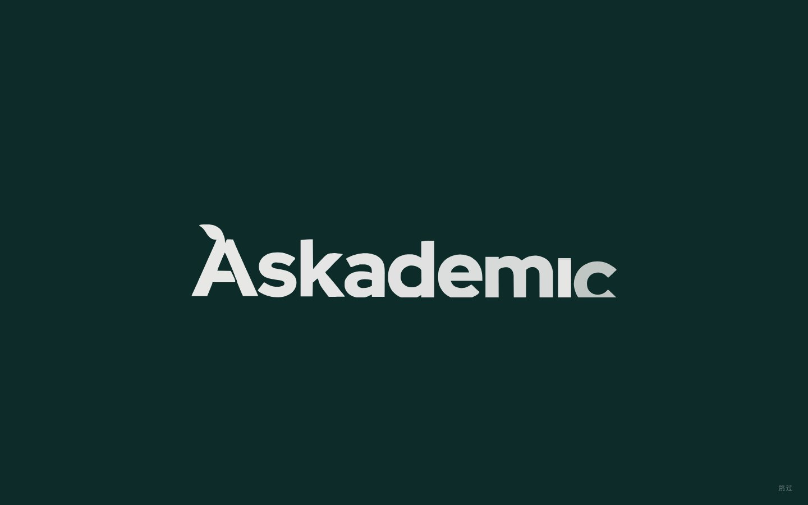
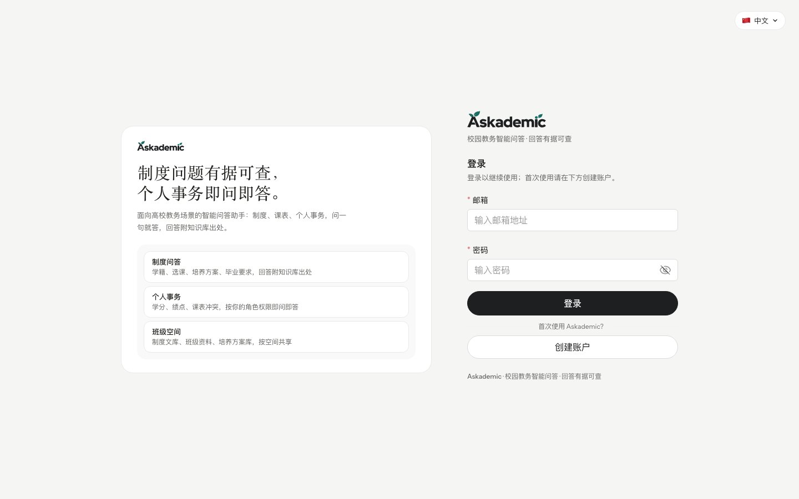
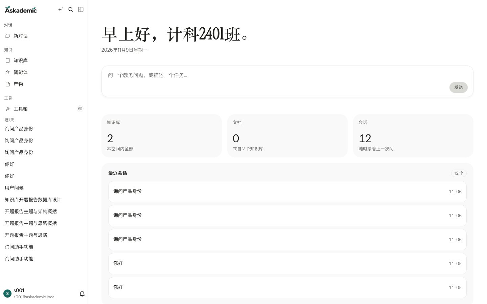
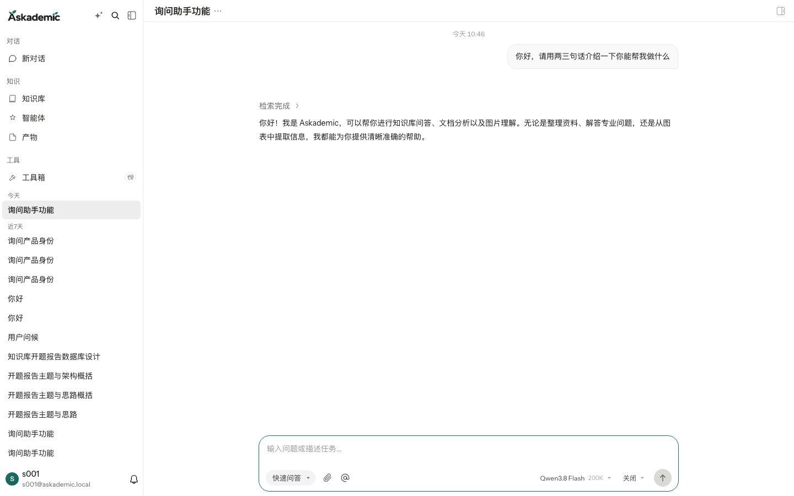
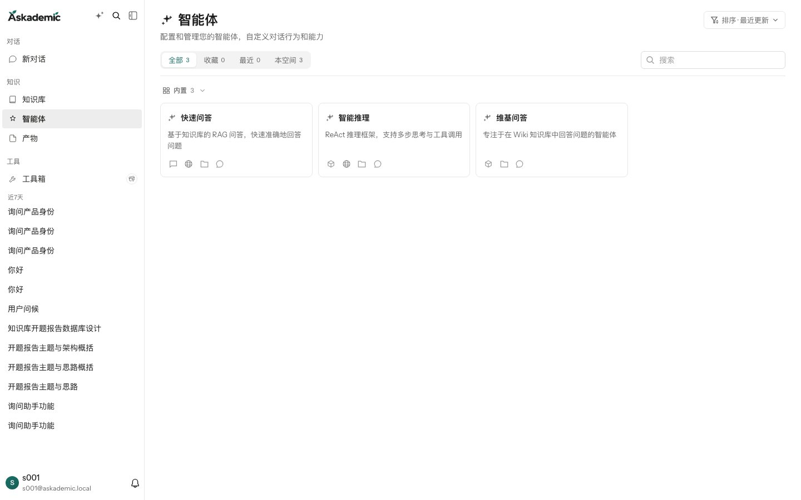
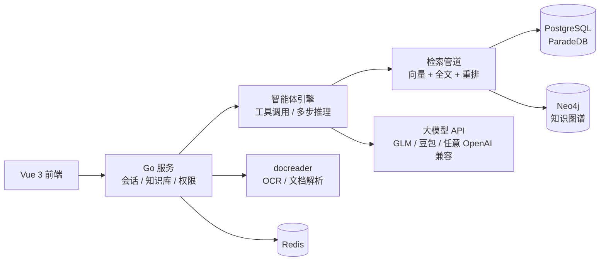

<div align="center">



# Askademic

**基于 RAG 与智能体的高校教务智能问答系统**

制度问题有据可查 · 个人事务即问即答

[界面预览](#界面预览) · [核心特性](#核心特性) · [快速开始](#快速开始) · [系统架构](#系统架构) · [开源来源与致谢](#开源来源与致谢)

</div>

## 这是什么

Askademic 是面向高校教务场景的智能问答系统：学校的制度文件、培养方案、办事流程上传进知识库后，学生、教师、辅导员和教务管理员可以用一句自然语言直接提问，回答附知识库出处；个人事务（学分、绩点、选课等）则按登录者的角色与空间权限返回属于他自己的数据，越权查询在数据层被直接拒绝。

> 本项目基于腾讯开源项目 [WeKnora](https://github.com/Tencent/WeKnora)（MIT License）二次开发，保留其检索增强生成（RAG）与智能体编排核心，围绕高校教务场景完成了品牌重塑、界面重设计、功能裁剪与场景化建设。详见[开源来源与致谢](#开源来源与致谢)。

## 界面预览

| 登录页 | 工作台 |
|---|---|
|  |  |
| **智能问答（回答附检索过程与出处）** | **内置智能体** |
|  |  |

## 核心特性

- **知识库问答（RAG）**：文档上传 → 解析（内置 OCR / 视觉语言模型双通道）→ 切片 → 向量与知识图谱抽取；回答附带知识库出处，有据可查。
- **智能体编排**：内置「快速问答」「智能推理」等智能体，支持工具调用与多步推理，可按空间配置。
- **多空间与角色隔离**：教务处 / 班级 / 个人三级空间，知识库按组织共享，成员按角色（owner / contributor / viewer）协作。
- **文档解析**：内置 RapidOCR 本地 OCR 与可选视觉语言模型（VLM）描述通道，扫描件与图文混排文档均可入库。
- **品牌与动效**：GSAP + SVG 的逐字渐出开场动画（每会话播放一次，支持跳过与 `prefers-reduced-motion` 降级）。
- **国际化**：六语言界面。

## 快速开始

### Docker Compose（推荐）

```bash
git clone https://github.com/incredibleIT/Askademic.git
cd Askademic
cp .env.example .env        # 按需修改密码、端口与密钥
docker compose up -d
```

启动后访问 `http://localhost`（前端容器默认 `FRONTEND_PORT=80`；后端 API 在 `APP_PORT=8080`）。

首次使用：注册管理员账号 → 在「设置 → 模型管理」中接入大模型与 Embedding 服务（API Key 加密存库，无需写入配置文件）→ 创建知识库并上传文档。

### 源码运行

```bash
# 后端（Go ≥ 1.26，需要 CGO）
make build      # go build -o WeKnora ./cmd/server
./WeKnora       # 默认监听 8080，依赖 PostgreSQL 与 Redis（可用 docker-compose.dev.yml 单独拉起）

# 前端
cd frontend
npm install
npm run build   # vite build，产物由后端静态托管
```

## 系统架构



| 组件 | 说明 |
|---|---|
| Go 服务 | 会话编排、知识库管理、空间与角色权限、模型接入（`cmd/server`） |
| Vue 3 前端 | TDesign 组件库，六语言，品牌动画（`frontend/`） |
| PostgreSQL (ParadeDB) | 业务数据 + 全文/向量检索（`internal/`） |
| docreader | 独立文档解析服务，内置 RapidOCR，纯本地运行 |
| Neo4j | 知识图谱存储（可选，图谱抽取开启时使用） |
| 大模型层 | 通过界面配置接入任意 OpenAI 兼容 API（LLM / Embedding / VLM / Rerank） |

## 目录结构

```
├── cmd/server/          # 服务入口
├── internal/            # Go 后端（handler / application / models / agent …）
├── frontend/            # Vue 3 前端
├── config/              # 内置智能体等 YAML 配置
├── docs/                # 设计文档、开发过程台账、部署脚本说明
└── docker-compose.yml   # 完整编排（app / frontend / postgres / redis / docreader …）
```

## 开发文档

- [`docs/ACADEMIC_TRIM_LOG.md`](docs/ACADEMIC_TRIM_LOG.md) —— 基于上游的二开过程台账（裁剪决策与执行记录）
- [`docs/superpowers/specs/`](docs/superpowers/specs/) —— 教务助手设计文档
- [`docs/superpowers/plans/`](docs/superpowers/plans/) —— 分阶段实施计划

## 开源来源与致谢

本项目基于腾讯开源项目 [WeKnora](https://github.com/Tencent/WeKnora) 二次开发，感谢腾讯与 WeKnora 社区的优秀工作。

- **许可证**：WeKnora 采用 MIT License，本仓库完整保留其原始许可文本（见 [LICENSE](LICENSE)）。
- **历史说明**：上游的完整提交历史不随本仓库分发；本仓库首个提交为上游基线快照，其后为本项目的开发提交。
- **主要修改**：品牌与界面重塑（Askademic）、面向高校教务场景的功能裁剪与界面重设计、教务业务功能建设（进行中）。

## License

本项目遵循 [MIT License](LICENSE)（含腾讯原版版权声明）。第三方组件许可以上游声明为准。
